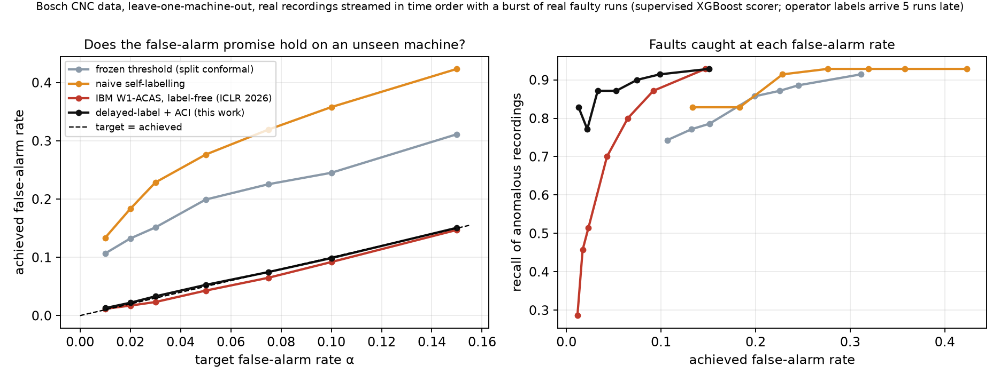
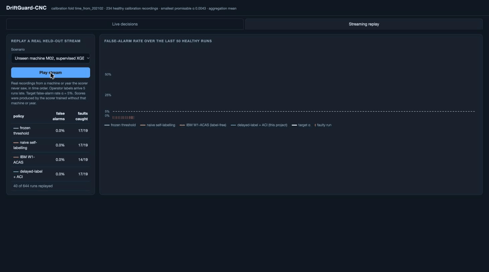
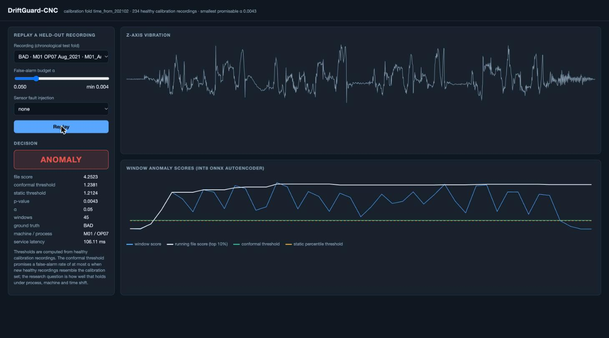

# DriftGuard-CNC

[](https://github.com/mithinsagar/driftguard-cnc/actions/workflows/ci.yml)

**False-alarm-controlled vibration anomaly detection on Bosch's CNC machining data, tested under the shifts that break real deployments: a new machining process, a new machine, a later time period.**

An engineer chooses a false-alarm budget α ("at most 5 in 100 healthy runs may raise an alarm"). DriftGuard-CNC sets thresholds to meet it, measures honestly whether the promise survives shift, keeps sensor faults separate from process anomalies, and ships an INT8 model that makes the same decisions as the full-precision one.

<!-- RESULTS:START -->


### Key results (generated from `results/`; α = 5% unless stated)

1. **The most accurate detector is the least trustworthy under shift.** Supervised XGBoost ranks faults best (mean PR-AUC 0.90 on unseen processes, 3 seeds), yet a static threshold set for 5% false alarms produced **42.9% false alarms** on the later time period and 18.3% on unseen machines.
2. **Label-free adaptive calibration fixes the rate.** IBM's W1-ACAS (ICLR 2026, run with IBM's code) brings those to 5.5% and 5.9%.
3. **Late operator feedback calibrates better (main result, held-out protocol).** Every tunable policy had its settings chosen on the first half of each real stream and was scored on the second half only. Admitting only operator-confirmed healthy runs to the calibration buffer and correcting the working α with ACI from the same late labels was better calibrated than IBM W1-ACAS in **32 of 40** held-out runs (16 settings, up to 3 training seeds each) against tuned W1-ACAS and 31 of 40 against its default settings. Recall at a matched 2% false-alarm rate was higher in 16 and lower in 13 of 31 comparable runs against tuned W1-ACAS (mean +9.0 points); against default W1-ACAS it was higher in 15 and lower in 13 (mean +2.1). Example, unseen machines with a burst of real faulty runs: **4.3% false alarms, 65.7% recall**, against 4.6% / 25.7% for tuned W1-ACAS and 26.9% false alarms for a frozen threshold. W1-ACAS needs no labels; this policy does, and it stays near target with 50% label coverage (6.1%) but drifts with 10% (12.0%).
4. **Naive self-labelling is worse than doing nothing.** Admitting every unflagged run raised unseen-machine false alarms from 19.9% (frozen) to 27.6%, the self-poisoning effect described in prior work, measured here on real factory streams.
5. **The edge model makes the same decisions and can warn early.** INT8 decisions agreed with FP32 on **99.8%** of 469 held-out recordings after recalibration (99.6% without); p95 latency 1.22 ms per 1 s window on one Apple M5 CPU core (FP32 1.20 ms); 188 KB. Alarming at the first crossing of the running score caught 10 of 17 faulty 2021 runs at a median of 1.0 s into the run, with 5.3% false alarms on healthy runs (end-of-run decisions: 7 of 17 at 3.1%).
6. **Negative results, reported:** similarity-weighted conformal thresholds did not beat pooled calibration under unseen processes, and adding a few confirmed runs of a new process barely moved static thresholds.

Secondary analysis without held-out tuning (whole streams, fixed settings): the same policy reached 5.3% false alarms with 87.1% recall in the example above; those numbers are more optimistic because the policy was designed on the same streams.

Tables: [held-out streaming](docs/holdout_tables.md), [offline calibration, all scorers and seeds](docs/results_tables.md), [whole-stream analysis](docs/stream_tables.md). Report: [docs/report.pdf](docs/report.pdf). Figures: [reports/figures/](reports/figures/).
<!-- RESULTS:END -->

## Demo



`make demo` starts the FastAPI service and dashboard on http://localhost:8000. Two tabs:

- **Streaming replay** (above): real recordings from a machine or year the scorer never saw, in time order, through four policies at α = 5%. On unseen machine M02 the frozen threshold climbs past 50% false alarms over the last 50 healthy runs, W1-ACAS recovers after a spike, and the delayed-label policy holds the budget while catching more of the faulty runs.
- **Live decisions**: score any held-out 2021 recording with the INT8 model, then press *Operator: healthy* or *Operator: faulty*. Confirmed healthy runs update the adaptive threshold through the same delayed-label + ACI calibrator used in the study (a unit test checks the service makes exactly the study's decisions); faulty confirmations never enter the calibration set. Injecting a sensor fault returns `SENSOR_FAULT`, never a process verdict.



API: `POST /v1/score` (n x 3 samples at 2 kHz) returns decision, run id, file score, adaptive and fixed thresholds, working α, p-value and latency; `POST /v1/feedback` applies a late operator confirmation; `PUT /v1/config` sets α and rejects values below what the calibration set can support; `GET /v1/demo/streams` serves the replay scenes. The service refuses to start if the calibration file was computed for a different model hash.

## Validate it yourself (about 15 minutes on a laptop)

```bash
git clone <this repository> && cd driftguard-cnc
make setup && make data     # downloads 0.9 GB from Bosch's repository, verifies 1,702 files by git blob SHA-1
make verify                 # re-runs Isolation Forest on 3 process folds and compares with committed results
make test                   # leakage, DSP, conformal maths, streaming policies, sensor gate, ONNX API tests
```

## Why this is hard

- **Thresholds do not transfer.** A detector tuned on one set of machining processes alarms constantly on another, so operators mute it.
- **Random window splits lie.** Windows from one recording share its process and tool state; splitting them randomly leaks the test set into training. Every split here is by recording.
- **Few anomalies.** 70 anomalous recordings among 1,702 (M03 has only 9), so recall estimates carry wide intervals, and they are reported with them.

## Data

[Bosch CNC Machining dataset](https://github.com/boschresearch/CNC_Machining) (Tnani, Feil, Diepold, Procedia CIRP 2022; data CC-BY-4.0): tri-axial Bosch CISS accelerometer at 2 kHz on three brownfield CNC milling machines (M01 to M03), 15 processes (OP00 to OP14), October 2018 to August 2021. `make data` downloads every file from the official repository, verifies each against its git blob SHA-1, checks the counts (1,702 recordings: 1,632 good, 70 bad), writes the audit in [docs/data_audit.md](docs/data_audit.md) and the split manifests in [splits/](splits/).

## Method

| Stage | What it does |
|---|---|
| Sensor health gate | Deterministic checks (NaN, flatline, clipping, stuck values, shape) before any model; returns `SENSOR_FAULT`, never a silent pass |
| Features | 1 s windows, 0.5 s hop, per-window mean removal; 81 DSP features (RMS, kurtosis, crest, spectral centroid, flatness, roll-off, 16 Welch bands per axis, cross-axis correlation) |
| Scorers | B0 RMS heuristic, B1 Isolation Forest, B2 XGBoost (supervised reference), AE compact 1D-CNN autoencoder (150k parameters, MSE + log-spectral loss), all trained on healthy recordings only (except B2) |
| Window to file | Aggregation rule (max, mean, top-10% mean) chosen on validation recordings |
| Calibration | C0 static percentile, C1 split conformal, C2 Mondrian per process, C4 similarity-weighted conformal (kernel width chosen by a nested pseudo-shift on validation data), C5 IBM W1-ACAS (their implementation) |
| Streaming calibration | Held-out recordings replayed in time order (natural, and with a contiguous burst of the real faulty runs); operator labels arrive k runs late. Policies: frozen, naive self-labelling, delayed-label admission, ACI from delayed errors, IBM W1-ACAS (label-free), and delayed-label admission + ACI (this work); swept over α to compare recall at matched false-alarm rate; label-coverage ablation |
| Edge | ONNX FP32 and static INT8 (QDQ, per-channel), recalibrated on INT8 scores; single-core latency |
| Serving | FastAPI service whose decisions use the delayed-label + ACI calibrator online, operator feedback endpoint, SHA-256 binding between model and calibration, dashboard with live decisions and streaming replay |

## Evaluation protocols

| Protocol | Test set | Shift |
|---|---|---|
| `lopo` | one machining process at a time (15 folds) | unseen process |
| `lomo` | one machine at a time (3 folds) | unseen machine |
| `time` | latest timeframes | later period |

Within the non-test part, healthy recordings are split 60/20/20 into train, validation and calibration, stratified by machine and process. Anomalous recordings outside the test group are used only for model selection and the supervised reference.

## Related work and what is new

See [docs/related_work.md](docs/related_work.md). In short: conformal anomaly detection, weighted conformal, ACI, the self-poisoning of self-labelled recalibration, and adaptive conformal monitoring (IBM W1-ACAS, ICLR 2026) are prior work. New here: a leak-free calibrated-decision benchmark on this real factory dataset; process-aware weighted calibration evaluated against those baselines under three shift types; a label-delay study on real chronological streams; and decision-level parity of an INT8 edge model.

## Reproduce

```bash
make setup      # Python 3.12 venv with pinned dependencies (+ IBM granite-tsfm for the W1-ACAS baseline)
make data       # download + verify (about 0.9 GB), audit, features, splits
make eval       # all scorers x calibration strategies x protocols (SEEDS="0 1 2" for three seeds)
make stream     # whole-stream study, label-coverage ablation, few-shot study
make holdout    # held-out streaming protocol: tune on first halves, score on second halves
make export     # ONNX FP32 + INT8, parity, latency, detection latency, dashboard replay scenes
make tables     # every table, figure, README result and the PDF report, regenerated from results/
make verify     # fast re-run compared with committed results (exact match expected)
make test
make demo       # http://localhost:8000
```

## Limitations

- 70 anomalous recordings (17 in the 2021 test period) limit statistical power; streaming results pool three machine folds and one time fold.
- Operator labels are simulated as correct and delayed by a fixed number of runs; real feedback is noisier.
- W1-ACAS was designed for foundation-model forecast residuals; here it calibrates recording-level scores from our scorers, with its own settings tuned on the same first halves as ours.
- Latency is measured on an Apple M5 CPU core, not on an industrial PC; INT8 is not faster than FP32 on this CPU.
- Labels are per recording; per-window anomaly labels do not exist and are never invented.
- The deployed autoencoder ranks anomalies worse than a simple RMS rule on this data; it is deployed because it is unsupervised and small, and the calibration layer is model-agnostic.

## Licence

Code: MIT. Data: CC-BY-4.0 (Bosch), not redistributed here. IBM W1-ACAS is used as an installed dependency (Apache-2.0).
